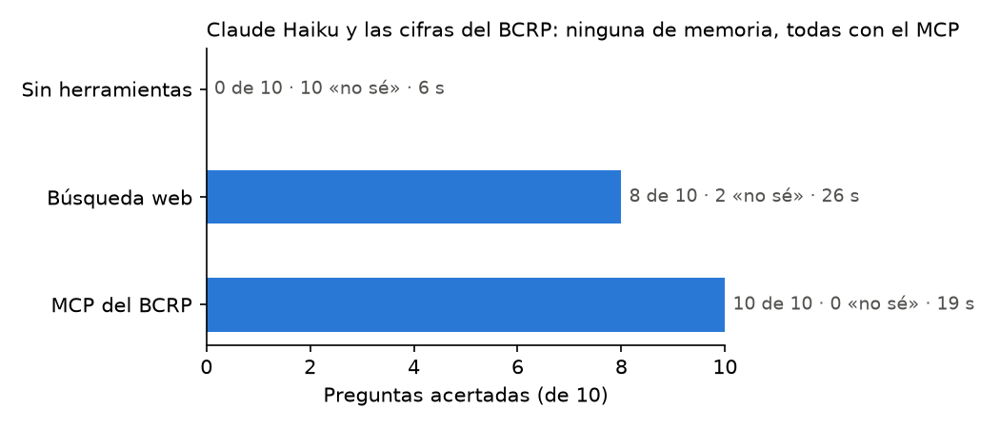

# Informe · ¿Inventa cifras Claude? Memoria, búsqueda web y un MCP del BCRP

Diez preguntas sobre cifras oficiales del BCRP (inflación, tasa de referencia, tipo de cambio, reservas, cobre, PBI,
exportaciones y desempleo), hechas a Claude Haiku con `claude -p` en tres modos. Las dos últimas preguntas
(`exp_ago26` y `desempleo_set26`) son propias, y su «verdad» sale de la tabla HTML del BCRP, no del MCP.

## Resultados

**Corrida base** (`resultados_base.csv`, `uv run evaluar.py`):

| Modo | Acierta | Se equivoca | «No sé» | Segundos promedio |
|---|---:|---:|---:|---:|
| memoria | 0 | 0 | 10 | 13.4 |
| mcp | 10 | 0 | 0 | 57.9 |

**Experimento extra: contra la búsqueda web** (`resultados.csv`, `uv run evaluar.py --modos memoria web mcp`):

| Modo | Acierta | Se equivoca | «No sé» | Segundos promedio |
|---|---:|---:|---:|---:|
| memoria | 0 | 0 | 10 | 6.0 |
| web | 8 | 0 | 2 | 25.5 |
| mcp | 10 | 0 | 0 | 19.1 |

Ningún modo inventó una cifra: cuando no sabía, Claude puso `null`. La diferencia está en cuántas veces pudo responder.

## Qué falló cada modo y por qué

- **Memoria (0 de 10):** respondió «no sé» en todas. En la columna `fuente` dice que su conocimiento no llega a esas
  fechas o que no tiene acceso al BCRP. Es la conducta correcta, porque la instrucción le pide no estimar.
- **Web (8 de 10):** falló en `referencia_set26` y `cobre_ago26`. En la tasa de referencia encontró el 4.25 % en una
  nota de peru-retail.com, pero no lo pudo confirmar en una página del BCRP y prefirió no responder. En el cobre, la
  búsqueda no llevó a la serie del BCRP y las cifras que aparecieron no coincidían. Además, en cuatro de sus aciertos la
  fuente no fue el BCRP: tres salieron de prensa (Andina, BBVA Research, Forbes Perú) y uno de la resolución del INEI en
  El Peruano. Acertó, pero con cifras de segunda mano y redondeadas.
- **MCP (10 de 10):** citó en todas el código de la serie, el periodo y la URL de la API del BCRP.

**El MCP también puede fallar por razones técnicas.** En la primera corrida, el MCP dijo «no sé» en las 10 preguntas.
En esta computadora, importar pandas y fastmcp tarda unos 30 s, y Claude Code solo espera 30 s a que el servidor
arranque: Claude respondía sin tener las herramientas. Se resolvió dándole más tiempo con `MCP_TIMEOUT=120000`, sin
cambiar el código. Por eso la corrida base tarda 58 s por pregunta, porque incluye ese arranque. En Windows, además,
hizo falta `PYTHONUTF8=1` para que `evaluar.py` leyera las tildes de la salida de `claude`.

## Dos cifras del MCP comprobadas a mano en la web del BCRP

| Pregunta | MCP | Web del BCRP | Tabla |
|---|---:|---:|---|
| Inflación de Lima a 12 meses, setiembre 2026 (PN01273PM) | 4.5487 | 4.55 | [estadisticas.bcrp.gob.pe/…/PN01273PM](https://estadisticas.bcrp.gob.pe/estadisticas/series/mensuales/resultados/PN01273PM/html/2026-7/2026-9/) |
| Tipo de cambio interbancario venta, 15 oct 2026 (PD04638PD) | 3.4282 | 3.428 | [estadisticas.bcrp.gob.pe/…/PD04638PD](https://estadisticas.bcrp.gob.pe/estadisticas/series/diarias/resultados/PD04638PD/html/2026-10-13/2026-10-15/) |

Las dos coinciden; la web solo muestra menos decimales. Pasa lo mismo con las preguntas propias: la web muestra
desempleo de 4.4 % y exportaciones de 10 815 millones de US$, mientras que la API da 4.3717 y 10 815.4042. Por eso la
tolerancia de redondeo es necesaria (0.05 y 10).

## Conclusión

Sin herramientas, Claude no sirve para cifras recientes: en el mejor caso dice «no sé». La búsqueda web basta para una
cifra suelta que sale en la prensa (inflación, PBI), pero falla con datos menos mediáticos (precio del cobre) y suele
citar a intermediarios en vez de la fuente oficial. Vale la pena construir un MCP cuando se consulta seguido la misma
fuente oficial, se necesitan cálculos repetibles (variaciones, promedios) y cada cifra debe llevar su código y periodo
para poder auditarla. El costo es mantener el servidor, que también puede fallar, como mostró el tiempo de arranque.
